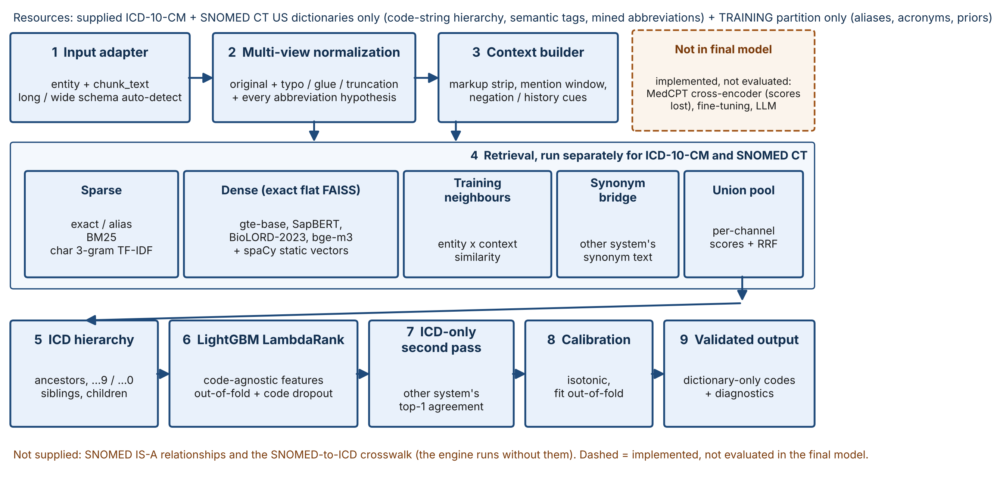
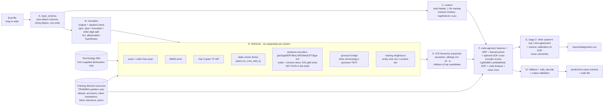

# TermMap architecture

 (generated by `scripts/make_pdf.py`)

## Stage map (module -> responsibility)

| stage | module | notes |
|---|---|---|
| A | `input_schema.py`, `io_adapter.py` | train-style long or statement-style wide; output mirrors input + always a wide file |
| B | `normalize.py` | views carry a `kind`; original never destroyed; vocab built from dictionaries |
| C | `context.py` | NegEx-style cue words (domain-general); what gold does with cues is learned |
| D | `retrieve_lexical.py`, `retrieve_static.py`, `retrieve_dense.py`, `retrieve_training.py`, `features.py` | exact sparse/dense dot products -> deterministic; dense sentence encoders optional |
| E | `features.py` (expansion), `specificity.py` (profile + safe decode) | hierarchy from ICD code strings in the dictionary |
| F | `features.py`, `rerank.py`, `cross_encoder.py` | no feature encodes code identity -> unseen/new codes compete equally; RRF + raw channel scores; learned conditional priors; CE scores (optional, OOF) |
| G | `stages.py`, `joint.py`, `crosswalk.py` | stage 2 adds the other system's first-pass text agreement as evidence; isotonic calibration; systems never collapsed |
| H | (off) | local LLM adjudication not implemented in the submitted run: no local LLM available, no measured gain to justify it |
| I | `predict.py`, `specificity.py` | most-frequent training code only when no candidate exists (empty entity and context) |
| J | `output_validation.py` | schema, row count/order, dictionary membership, no NaN; raises on violation |

## Resumability (iteration 2)

* Feature tables: one hash-keyed file per OOF fold / eval set under `models/cache/` (`pipeline._cached`).
* Dense embeddings: string-level `EmbeddingStore` flushed every N batches; incremental on dictionary change.
* Fine-tuning / cross-encoder: checkpoint directories with step counters; finished pieces skipped on rerun.
* Cross-encoder scores: disk cache keyed by (model, text pair) -> identical replay across runs.

## Leakage control

* Group split: union-find over normalized entity and identical chunk text.
* All training-derived resources (aliases, neighbours, acronyms, translations, relevance, priors)
  are rebuilt per experiment from the training partition only; reranker training tables are
  out-of-fold (5 grouped folds), so no training query ever sees itself.
* Code-disjoint fold: 20% of distinct gold codes per system; every pair carrying such a code in
  either system is removed from all training resources and from reranker training.
* FINAL TEST split (15% of groups, carved from non-validation groups): excluded from all training resources,
  from the code-disjoint experiment and from fine-tuning; scored once after freezing.
* Fine-tuning data excludes validation, FINAL TEST rows and every code-disjoint code (asserted).
* Final model: refit on all pairs (train + val + test) with the frozen configuration (disclosed).
